<div align="center">
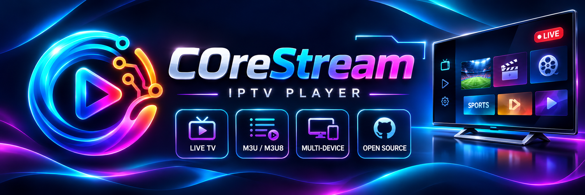
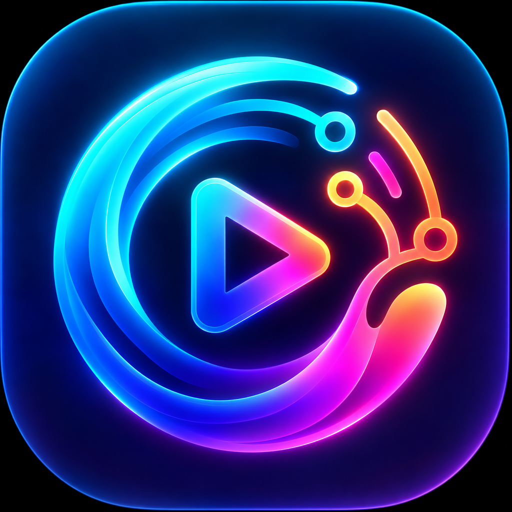
<h1>C0reStream</h1>
<p><strong>Your Streams. Your Rules.</strong></p>

[](https://github.com/klatschanstalt/C0reStream/actions/workflows/build-apk.yml)
[](https://github.com/klatschanstalt/C0reStream/releases/latest)
[](https://github.com/klatschanstalt/C0reStream/releases)
[](LICENSE)

[Deutsch](#-deutsch) • [English](#-english) • [Français](#-français)
</div>

---

# 🇩🇪 Deutsch

C0reStream ist ein moderner Android-Media-Client für eigene oder autorisierte IPTV-Playlists und VOD-Bibliotheken.

> [!IMPORTANT]
> Kein Content-Anbieter: Keine IPTV-Inhalte, Abos, Accounts oder vorinstallierten Streams.

## 📥 APK Download & Prüfung

- **[C0reStream.apk](https://github.com/klatschanstalt/C0reStream/releases/latest/download/C0reStream.apk)**
- [GitHub Releases](https://github.com/klatschanstalt/C0reStream/releases/latest)
- [SHA256SUMS](https://github.com/klatschanstalt/C0reStream/releases/latest/download/SHA256SUMS)

<details>
<summary>Certificate SHA-256</summary>

`65FB26B0F6175832` `28EA8813080FA7E2` `F8F6421022D8D279` `F928C726EA6E8543`

</details>

```bash
sha256sum --check SHA256SUMS
```

> [!NOTE]
> Bei Erstinstallation gegebenenfalls „Unbekannte Apps installieren“ erlauben.

## ✨ Funktionsübersicht

- 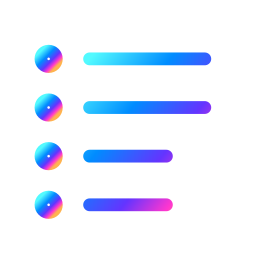 **Playlists:** M3U/M3U8, Xtream Codes, lokale Dateien, stabile Sender-IDs, Deduplizierung, Gruppen, Favoriten, automatische Aktualisierung, Importstatistiken und paginierter Senderzugriff.
-  **Player:** Media3 (HLS/DASH/MPEG-TS, RTSP/RTP-Unicast), Mini-Player, Hintergrundwiedergabe, PiP, Vollbild mit neun Skalierungsmodi, Spurwahl, erweiterte Codec-Diagnostik, Sleep-Timer, Reconnect, Catch-up und VOD-Fortsetzung.
- **EPG:** XMLTV (unkomprimiert oder GZIP), Programmführer, Cache und Erinnerungen.
- **VOD:** Filme, Serien, Episoden, Suche, Merkliste und Fortschritt.
- **Profile & Tools:** PIN-Schutz, QR-Import und autorisierte Aufnahme ungeschützter Streams.
- **Backup:** Verschlüsselte Sicherung und Wiederherstellung von Einstellungen, Favoriten, Verlauf, Fortschritt, Merkliste und Erinnerungen.
-  **Oberfläche:** Material 3, Hell/Dunkel/AMOLED, responsiv, DE/EN/FR, Android-TV-Launcher und D-Pad-Navigation.
- **Einstellungen:** Expertenmodus, Reset, globale und senderbezogene Wiedergabeprofile.
- **Updates:** Signierte Ressourcenmanifeste und APK-Updates mit SHA-256-, Paketnamen- und Signaturprüfung.
- **Sicherheit:** Android Keystore, begrenzte Parser, URL-Validierung, HTTPS-Downgrade-Schutz. Keine Werbung, Analysen oder Tracking.

> [!WARNING]
> HTTP bleibt unterstützt; HTTPS wird empfohlen.

RTSP/RTP-Unicast ist integriert; rohes UDP und Multicast sind noch nicht abspielbar. FFmpeg-Softwaredecoder sind ohne separat gebaute Erweiterung nicht verfügbar.

## 📱 Voraussetzungen

Android 11 (API 30) oder neuer. Physische TV-Hardware ist nicht Teil der automatisierten Testmatrix. Target API 37 · Compile SDK 37.1.


## 🛠️ Build & Rechtliches

```bash
./gradlew :app:testDebugUnitTest
./gradlew :app:lintDebug
./gradlew :app:assembleRelease
./gradlew :app:connectedDebugAndroidTest
```

<details>
<summary>Toolchain · Signing · Documentation</summary>

- JDK 17 · SDK 37.1 · Build-Tools 37.0.0 · Gradle 9.9.2
- Production signing: `ANDROID_KEYSTORE_FILE`, `ANDROID_KEYSTORE_PASSWORD`, `ANDROID_KEY_ALIAS`, `ANDROID_KEY_PASSWORD`, `ANDROID_CERT_SHA256`.
- [SECURITY.md](SECURITY.md) · [PROJECT_STATUS_REPORT.md](PROJECT_STATUS_REPORT.md) · [Branding](assets/branding/) · [Previews](docs/)
- Apache License 2.0: [LICENSE](LICENSE) · [NOTICE.md](NOTICE.md) · [THIRD_PARTY_NOTICES.md](THIRD_PARTY_NOTICES.md)

</details>

---

# 🇬🇧 English

C0reStream is a modern Android media client for user-supplied, authorized IPTV playlists and VOD libraries.

> [!IMPORTANT]
> No content provided: No IPTV content, subscriptions, accounts or bundled streams.

## 📥 APK Download & Verification

- **[C0reStream.apk](https://github.com/klatschanstalt/C0reStream/releases/latest/download/C0reStream.apk)**
- [GitHub Releases](https://github.com/klatschanstalt/C0reStream/releases/latest)
- [SHA256SUMS](https://github.com/klatschanstalt/C0reStream/releases/latest/download/SHA256SUMS)

<details>
<summary>Certificate SHA-256</summary>

`65FB26B0F6175832` `28EA8813080FA7E2` `F8F6421022D8D279` `F928C726EA6E8543`

</details>

```bash
sha256sum --check SHA256SUMS
```

> [!NOTE]
> First installation may require allowing Install unknown apps.

## ✨ Key Features

-  **Playlists:** M3U/M3U8, Xtream Codes, local files, stable channel IDs, deduplication, groups, favourites, automatic refresh, import statistics and paged channel browsing.
-  **Player:** Media3 (HLS/DASH/MPEG-TS, RTSP/RTP unicast), mini-player, background playback, PiP, nine fullscreen scaling modes, track selection, extended codec diagnostics, sleep timer, reconnect, catch-up and VOD resume.
- **EPG:** XMLTV (plain or gzip), programme guide, cache and reminders.
- **VOD:** Movies, series, episodes, search, watchlist and resume positions.
- **Profiles & tools:** PIN protection, QR import and authorized recording of unprotected streams.
- **Backup:** Encrypted backup and restore of settings, favourites, history, progress, watchlist and reminders.
-  **Interface:** Material 3, Light/Dark/AMOLED, responsive layout, DE/EN/FR, Android TV launcher and D-pad navigation.
- **Settings:** Expert mode, reset, global and per-channel playback preferences.
- **Updates:** Signed resource manifests and APK updates with SHA-256, package-name and certificate checks.
- **Security:** Android Keystore, bounded parsers, URL validation and HTTPS downgrade protection. No ads, analytics or tracking.

> [!WARNING]
> HTTP remains supported; HTTPS is preferred.

RTSP/RTP unicast is integrated; raw UDP and multicast playback are not yet available. FFmpeg software decoders require a separately built extension.

## 📱 Requirements

Android 11 (API 30) or newer. Physical TV hardware is not part of the automated test matrix. Target API 37 · Compile SDK 37.1.


## 🛠️ Build & Legal

```bash
./gradlew :app:testDebugUnitTest
./gradlew :app:lintDebug
./gradlew :app:assembleRelease
./gradlew :app:connectedDebugAndroidTest
```

<details>
<summary>Toolchain · Signing · Documentation</summary>

- JDK 17 · SDK 37.1 · Build-Tools 37.0.0 · Gradle 9.9.2
- Production signing: `ANDROID_KEYSTORE_FILE`, `ANDROID_KEYSTORE_PASSWORD`, `ANDROID_KEY_ALIAS`, `ANDROID_KEY_PASSWORD`, `ANDROID_CERT_SHA256`.
- [SECURITY.md](SECURITY.md) · [PROJECT_STATUS_REPORT.md](PROJECT_STATUS_REPORT.md) · [Branding](assets/branding/) · [Previews](docs/)
- Apache License 2.0: [LICENSE](LICENSE) · [NOTICE.md](NOTICE.md) · [THIRD_PARTY_NOTICES.md](THIRD_PARTY_NOTICES.md)

</details>

---

# 🇫🇷 Français

C0reStream est un client multimédia Android moderne pour les playlists IPTV et bibliothèques VOD autorisées fournies par l’utilisateur.

> [!IMPORTANT]
> Aucun contenu fourni : aucun contenu IPTV, abonnement, compte ou flux intégré.

## 📥 Téléchargement APK & Vérification

- **[C0reStream.apk](https://github.com/klatschanstalt/C0reStream/releases/latest/download/C0reStream.apk)**
- [GitHub Releases](https://github.com/klatschanstalt/C0reStream/releases/latest)
- [SHA256SUMS](https://github.com/klatschanstalt/C0reStream/releases/latest/download/SHA256SUMS)

<details>
<summary>Certificate SHA-256</summary>

`65FB26B0F6175832` `28EA8813080FA7E2` `F8F6421022D8D279` `F928C726EA6E8543`

</details>

```bash
sha256sum --check SHA256SUMS
```

> [!NOTE]
> La première installation peut nécessiter l’autorisation d’installer des applications inconnues.

## ✨ Fonctionnalités clés

-  **Playlists:** M3U/M3U8, Xtream Codes, fichiers locaux, identifiants stables, déduplication, groupes, favoris, actualisation automatique, statistiques et navigation paginée.
-  **Lecteur :** Media3 (HLS/DASH/MPEG-TS, RTSP/RTP unicast), mini-lecteur, arrière-plan, PiP, neuf modes plein écran, sélection des pistes, diagnostics codec étendus, minuterie, reconnexion, catch-up et reprise VOD.
- **EPG:** XMLTV (brut ou gzip), guide, cache et rappels.
- **VOD:** films, séries, épisodes, recherche, liste de suivi et reprise.
- **Profils et outils:** code PIN, import QR et enregistrement autorisé des flux non protégés.
- **Sauvegarde:** sauvegarde et restauration chiffrées des paramètres, favoris, historique, progression, liste de suivi et rappels.
-  **Interface:** Material 3, clair/sombre/AMOLED, adaptative, DE/EN/FR, lanceur Android TV et navigation D-pad.
- **Paramètres:** mode expert, réinitialisation, préférences globales ou par chaîne.
- **Mises à jour:** manifestes signés et APK vérifiés par SHA-256, nom de paquet et certificat.
- **Sécurité:** Android Keystore, analyseurs bornés, validation des URL et protection contre le déclassement HTTPS. Sans publicité, analyse ni pistage.

> [!WARNING]
> HTTP reste pris en charge ; HTTPS est recommandé.

RTSP/RTP unicast est intégré ; la lecture UDP brute et multicast reste indisponible. Les décodeurs logiciels FFmpeg nécessitent une extension compilée séparément.

## 📱 Prérequis

Android 11 (API 30) ou supérieur. Le matériel TV physique ne fait pas partie des tests automatisés. Target API 37 · Compile SDK 37.1.


## 🛠️ Compilation & Mentions légales

```bash
./gradlew :app:testDebugUnitTest
./gradlew :app:lintDebug
./gradlew :app:assembleRelease
./gradlew :app:connectedDebugAndroidTest
```

<details>
<summary>Toolchain · Signing · Documentation</summary>

- JDK 17 · SDK 37.1 · Build-Tools 37.0.0 · Gradle 9.9.2
- Production signing: `ANDROID_KEYSTORE_FILE`, `ANDROID_KEYSTORE_PASSWORD`, `ANDROID_KEY_ALIAS`, `ANDROID_KEY_PASSWORD`, `ANDROID_CERT_SHA256`.
- [SECURITY.md](SECURITY.md) · [PROJECT_STATUS_REPORT.md](PROJECT_STATUS_REPORT.md) · [Branding](assets/branding/) · [Previews](docs/)
- Apache License 2.0: [LICENSE](LICENSE) · [NOTICE.md](NOTICE.md) · [THIRD_PARTY_NOTICES.md](THIRD_PARTY_NOTICES.md)

</details>

---

## Branding · Visuels

<details>
<summary>Branding gallery · Galerie graphique</summary>

### adaptive background


[PNG](assets/branding/adaptive-background.png) · [SVG](assets/branding/adaptive-background.svg)

### adaptive foreground

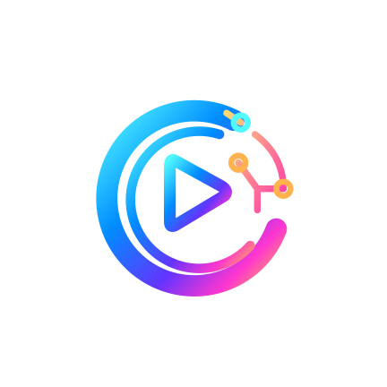

[PNG](assets/branding/adaptive-foreground.png) · [SVG](assets/branding/adaptive-foreground.svg)

### app icon neon


[PNG](assets/branding/app-icon-neon.png)

### app icon

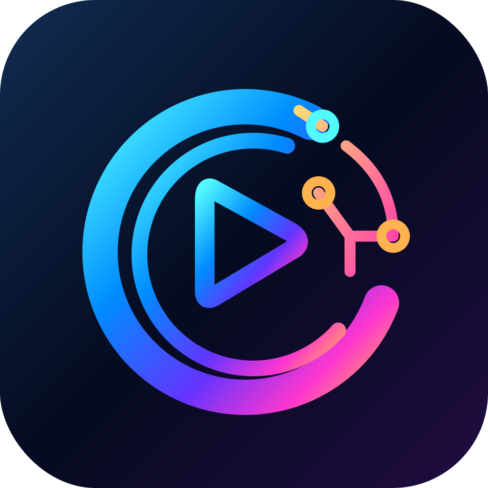

[PNG](assets/branding/app-icon.png) · [SVG](assets/branding/app-icon.svg)

### facebook banner

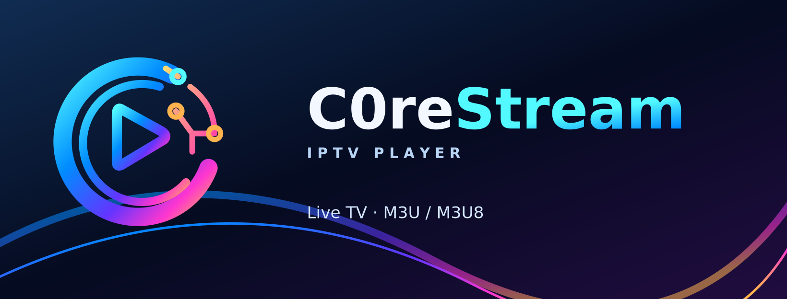

[PNG](assets/branding/facebook-banner.png) · [SVG](assets/branding/facebook-banner.svg)

### feature m3u


[PNG](assets/branding/feature-m3u.png) · [SVG](assets/branding/feature-m3u.svg)

### feature multi device


[PNG](assets/branding/feature-multi-device.png) · [SVG](assets/branding/feature-multi-device.svg)

### feature open source


[PNG](assets/branding/feature-open-source.png) · [SVG](assets/branding/feature-open-source.svg)

### feature streaming


[PNG](assets/branding/feature-streaming.png) · [SVG](assets/branding/feature-streaming.svg)

### github icon

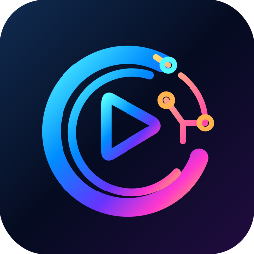

[PNG](assets/branding/github-icon.png) · [SVG](assets/branding/github-icon.svg)

### github readme neon


[PNG](assets/branding/github-readme-neon.png)

### github readme

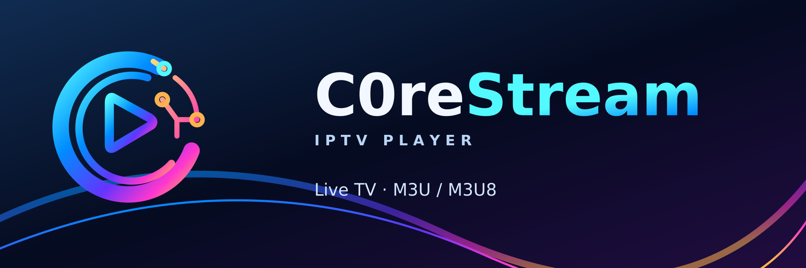

[PNG](assets/branding/github-readme.png) · [SVG](assets/branding/github-readme.svg)

### github social preview

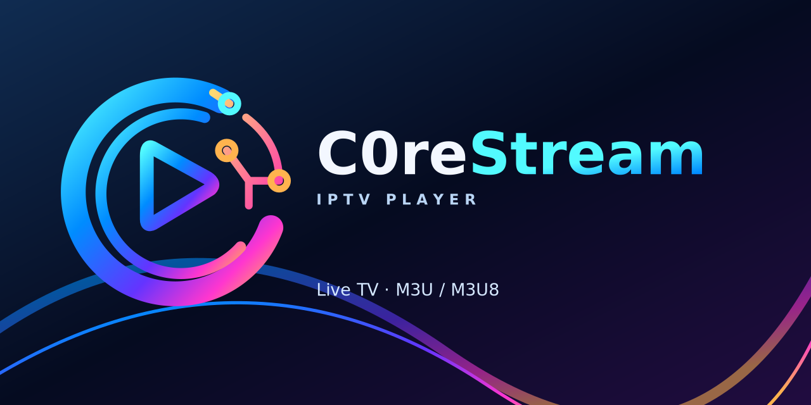

[PNG](assets/branding/github-social-preview.png) · [SVG](assets/branding/github-social-preview.svg)

### logo transparent

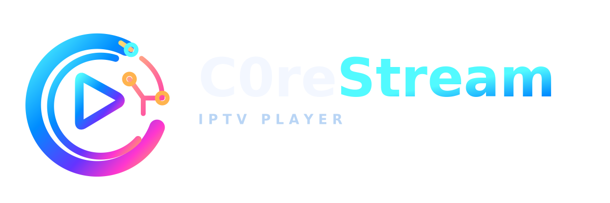

[PNG](assets/branding/logo-transparent.png) · [SVG](assets/branding/logo-transparent.svg)

### promotional banner

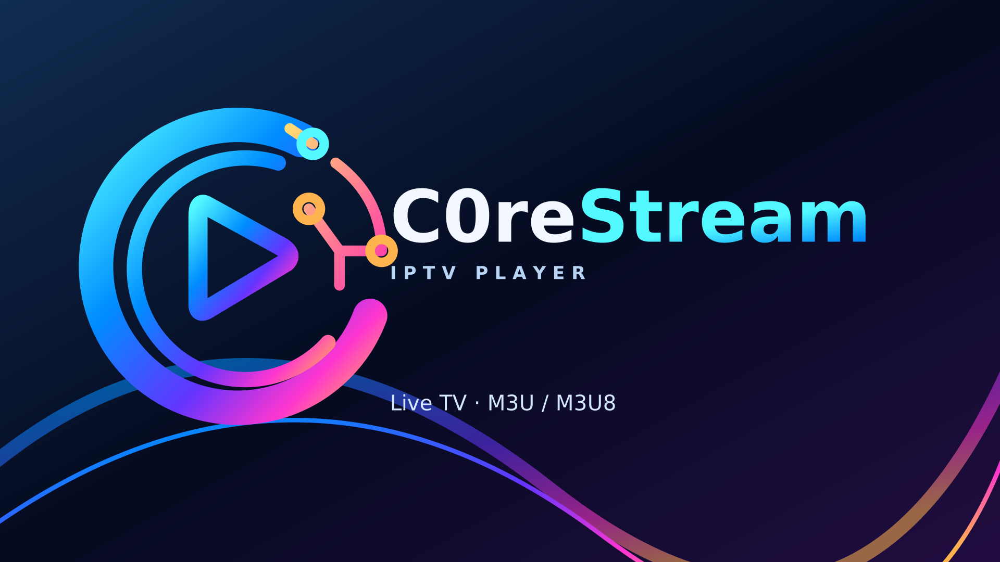

[PNG](assets/branding/promotional-banner.png) · [SVG](assets/branding/promotional-banner.svg)

### social post

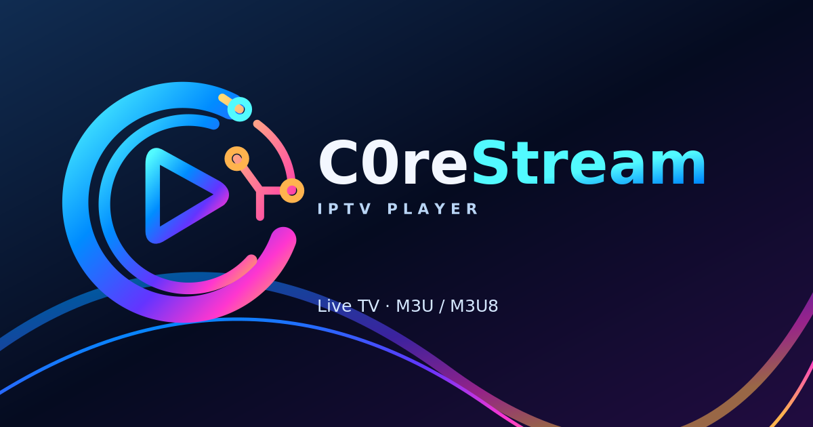

[PNG](assets/branding/social-post.png) · [SVG](assets/branding/social-post.svg)

### social profile

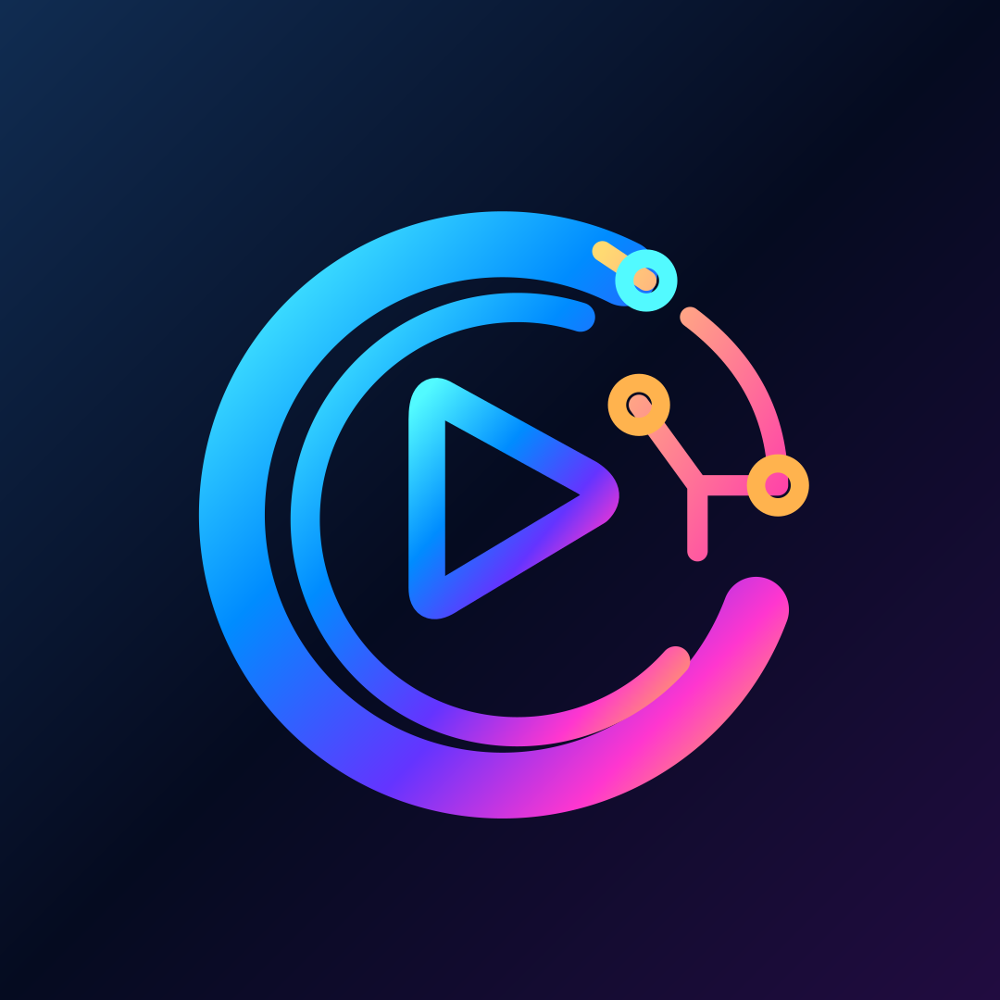

[PNG](assets/branding/social-profile.png) · [SVG](assets/branding/social-profile.svg)

### splashscreen

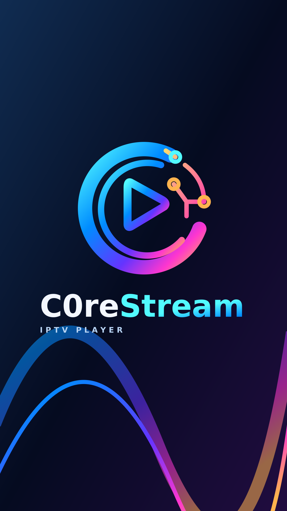

[PNG](assets/branding/splashscreen.png) · [SVG](assets/branding/splashscreen.svg)

</details>
